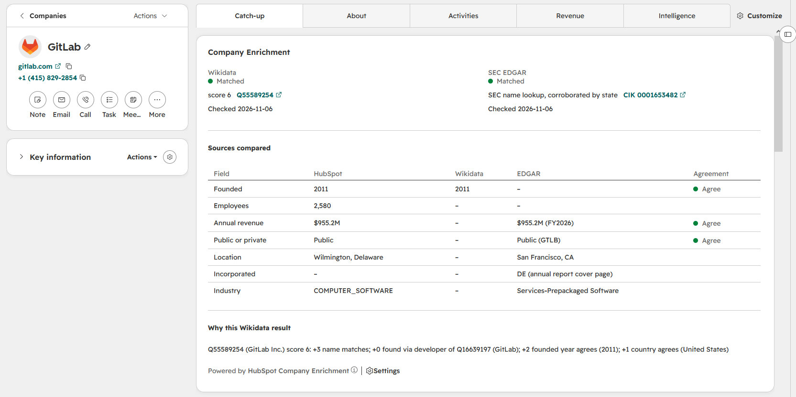

# HubSpot Company Enrichment

Enriches HubSpot company records from two open sources, matched by website domain:

- **[Wikidata](https://www.wikidata.org/)**: founding year, industry, employee count.
- **[SEC EDGAR](https://www.sec.gov/edgar)**: ticker, exchange, SIC industry, annual revenue, state of incorporation, business address.

Fetching the data is easy. The hard part is **matching it to the right record**: a company's website also leads to its founders, its products, Python packages and duplicate legal entities. This tool decides which candidate (if any) is the company, records why, and writes nothing it isn't confident about.

```text
$ python -m enrichment.cli --dry-run        # first run against the 16 sample companies, abridged
Would update 16 companies:
  GitLab  [Q55589254 (GitLab Inc.) score 6: +3 name matches; +0 found via developer of Q16639197 (GitLab);
           +2 founded year agrees (2011); +1 country agrees (United States)]
      wikidata_id: (empty) -> Q55589254
      wikidata_founded_year: (empty) -> 2011
      edgar_ticker: (empty) -> GTLB
      edgar_annual_revenue: (empty) -> 955224000
      edgar_match_method: (empty) -> sec_name_lookup
  ...
No Wikidata item with this website: 3
  Biodesix, Clay, Dandy
Ambiguous, needs review: 0

EDGAR:
  Matched, CIK from Wikidata: 11
  Matched, SEC name lookup corroborated by state: 2  (Biodesix, GitLab)
  No CIK found: 3  (Clay, Dandy, Zapier)

Timing (16.6s total):
  Wikidata: find candidates        0.42s
  Wikidata: fetch details          2.74s
  Organization check (local)       5.33s
  EDGAR: fetch                     7.46s
  ...
```

## On the company record

A HubSpot UI extension card (React + TypeScript) shows each source's status, how the match was made, and where the sources agree:



The card only reads properties the Python run has stored, so it needs no backend or extra scopes. Founded year, employees, revenue and public/private get an agreement verdict, using the same tolerances as `enrichment.compare`; location, incorporation and industry are shown side by side. On GitLab's record, HubSpot's "Wilmington, Delaware" sits next to the SEC's "San Francisco, CA" and "DE (annual report cover page)."

## How matching works

### Wikidata, by website

Every candidate shares the company's website. That's necessary, not sufficient:

1. **Only organizations count.** Each candidate's types are walked up Wikidata's subclass tree. This excludes HubSpot's co-founder (his entry lists `hubspot.com` as his website) and a Python package named `datadog`.
2. **Products point to their company.** A product's "developer" and "owned by" links are followed. Wikidata's `gitlab.com` item is GitLab the *product*; its developer link leads to **GitLab Inc.** Links from people are never followed.
3. **Each organization is scored on independent evidence:**

   | Signal | Points |
   |---|---|
   | Name matches HubSpot's, ignoring legal suffixes | +3 exact, +2 partial |
   | Founded year within ±1 of HubSpot's | +2, or −2 |
   | Country matches HubSpot's (as ISO codes) | +1, or −1 |
   | Employee count more than 10× off HubSpot's | −1 |
   | Website is Wikidata's preferred / deprecated value | +1 / −1 |

   HubSpot-based signals count only when HubSpot has a value, so the tool works with or without HubSpot's own enrichment.
4. **Sitelinks only break exact ties.** Popularity alone picks wrong: the Notion *app* has 23 Wikipedia articles, the Notion *company* none.
5. **When in doubt, write nothing.** A best score below 3, or an exact tie, is reported as *ambiguous, needs review*. A wrong match does more harm than no match, because it looks trustworthy.

### EDGAR, by CIK

1. **CIK from the Wikidata match.** The SEC's registered name must agree with HubSpot's before anything is written, because Wikidata sometimes attaches a CIK to the wrong item.
2. **Otherwise, by name in the SEC ticker list**, held to a higher bar than website matching: an exact match after normalizing ("GitLab" = "Gitlab Inc."), exactly one filer with that name, and HubSpot's state must equal the SEC business-address state *or* state of incorporation. Matches that fail are reported, not written.
3. **Two-way:** a CIK found by name is also looked up in Wikidata, in case Wikidata knows the company without its website.

Each record stores how its CIK was found (`edgar_match_method`), so the two methods can be trusted differently.

## Findings from real data

`python -m enrichment.compare` measures agreement between sources from the values stored in HubSpot. For the 16 sample companies:

| Field | Sources | Result |
|---|---|---|
| Public or private | HubSpot vs EDGAR ticker | 13 of 13 agree |
| Location | HubSpot state vs SEC business address | 11 of 12 agree; GitLab matches only the state of incorporation |
| Founded year | HubSpot vs Wikidata | 11 of 12 identical; Zapier one year off |
| Employees | HubSpot vs Wikidata | 4 of 5 within 10%; Salesforce 2.4× apart (83,334 vs 35,000) |
| Annual revenue | HubSpot vs latest 10-K | 10 of 10 identical |
| Industry | all three | Not comparable: three classification systems |

Other findings:

- **The SEC's own metadata is unreliable for state of incorporation.** It said HubSpot "NY" and Datadog "NV", and was blank for Wayfair and Atlassian; all four are Delaware corporations according to their 10-K cover pages. Incorporation is now read from the latest annual report's tagged cover page, with the metadata as a fallback, and the source recorded in `edgar_incorporation_source`.
- **HubSpot's built-in enrichment records incorporation addresses as locations.** It placed GitLab, a fully remote company, in Wilmington, Delaware. It also put Wayfair at 2,000 employees and classified a dental-technology company as "Facilities Services."
- **Filled isn't the same as correct.** Every company got a logo from HubSpot; Etsy's was a generic placeholder.
- **Wikidata has quirks.** Some items (Etsy) store their name only under the language-neutral `mul` label. GitLab's *product* item carries GitLab Inc.'s SEC CIK and an alias of "Zoom."
- **EDGAR's metadata needs cleaning.** The filer category contains HTML (`"...filer<br>Smaller reporting company"`), and foreign countries are SEC codes (Shopify: `Z4` for Canada).
- **Country names need a real lookup table.** HubSpot's country field is free text. Countries are compared as ISO codes via a table generated from Wikidata (1,873 names and aliases, 260 countries). Aliases claimed by two countries ("SA": Saudi Arabia and South Africa) are dropped, and an unrecognized value counts as no evidence, never as a mismatch.

## Design decisions

- **Each source writes to its own properties** (`wikidata_*`, `edgar_*`), not to HubSpot's `industry` or `numberofemployees`. See the next section.
- **Every outcome is recorded on the record**: match status, score, reasons and last-checked date, per source. A saved view of ambiguous companies becomes a review queue; reports show match rates and staleness; a workflow can assign review tasks.
- **Update by record ID; upsert only where it belongs.** Enrichment starts from existing records, so updating by ID can't create duplicates. The seed script upserts on a custom `normalized_domain` property with unique values enforced; HubSpot's `domain` doesn't enforce uniqueness, so it can't be an upsert key.
- **Reruns write only what changed**, comparing numbers numerically.
- **Company data only.** Wikidata's people fields (CEOs, founders) aren't used. Contact enrichment needs a licensed provider and a lawful basis for processing.
- **Sources fetch; the app evaluates.** Running the organization check on Wikidata's server took over 30 seconds and used up its per-client query-time budget. Doing it locally with a cache brought the Wikidata stage from 40–60 seconds (or a timeout) to about 8.
- **Polite clients.** Both public sources get a descriptive User-Agent; the SEC also requires a contact email and allows 10 requests per second, so the EDGAR client throttles itself.
- **Retries only where they help:** 429, 5xx, timeouts and dropped connections, honoring `Retry-After`, otherwise exponential backoff with jitter. Other 4xx errors fail immediately.
- **Partial batch failures (HTTP 207) are reported per record**, not hidden.
- **Raw HTTP instead of HubSpot's SDK**, to show paging, batching and retries. In production I'd likely use [`hubspot-api-client`](https://github.com/HubSpot/hubspot-api-client-python).
- **Pinned HubSpot API version** (`2026-09`), set in one place.
- **Setup is code.** Custom properties are defined in [`enrichment/properties.py`](enrichment/properties.py) and created when missing.

## When enriched data should overwrite the real fields

Teams usually want enrichment in the fields people use. Staging it in source-named properties first is deliberate: when a source may overwrite a real field is a business decision, made per field.

- **Blank or filled?** Filling blanks is low-risk. Overwriting what a rep entered isn't; reps know things no source does.
- **Trust per field.** Founded year (11 of 12 agree) and filed revenue are good candidates. Employee counts need a recency check. Industries need a mapping table between classification systems.
- **Match confidence.** A rule can require a minimum `wikidata_match_score`, or prefer `wikidata_cik` over `sec_name_lookup`.
- **Precedence between sources.** E.g. EDGAR for revenue and incorporation, Wikidata for founded year. The sources rarely cover the same field, so majority voting isn't yet possible for most fields.
- **Ownership.** The rule fits best in a HubSpot workflow that operations can see and change; property history makes a bad promotion traceable and reversible.

Once a source has silently overwritten a field, there's nothing left to compare it against.

## Setup

**Requirements:** Python 3.12+, Node.js (for the card), the [HubSpot CLI](https://developers.hubspot.com/docs/developer-tooling/local-development/hubspot-cli/install-the-cli), and a HubSpot account. A free [developer test account](https://developers.hubspot.com/docs/getting-started/account-types) works.

1. **Install:**

   ```bash
   python -m venv .venv
   source .venv/bin/activate          # Windows: .venv\Scripts\Activate.ps1
   python -m pip install -r requirements-dev.txt
   ```

2. **Create the HubSpot app.** Its scopes are in [`hubspot/`](hubspot/src/app/app-hsmeta.json): company read/write and company property read/write.

   ```bash
   cd hubspot
   hs project upload
   ```

   Install the app into your account from its **Distribution** tab; the access token appears there.

3. **Configure:** copy `.env.example` to `.env` and add the token. For EDGAR, also set `SEC_USER_AGENT` to a name and contact email, as the SEC requires; without it, EDGAR is skipped.

4. **Load sample companies** (optional). Upserts on `normalized_domain`, so reruns don't duplicate:

   ```bash
   python -m enrichment.seed
   ```

5. **Add the card** (optional). Install its dependencies, upload, then add it to the company record view (**Customize** → a tab → **+** → **Card library**, filter **App** → **Company Enrichment**):

   ```bash
   cd hubspot/src/app/cards && npm install && cd ../../..
   hs project upload
   ```

   `hs project dev` serves the card locally for faster iteration.

## Usage

```bash
python -m enrichment.cli --dry-run      # show what would change; writes nothing
python -m enrichment.cli                # apply
python -m enrichment.cli --limit 5      # first 5 companies with a domain
python -m enrichment.compare            # source agreement, read-only (--markdown for tables)
python -m pytest                        # tests fake all HTTP; no account or network needed
```

Maintenance:

```bash
python -m enrichment.build_countries    # regenerate data/countries.csv from Wikidata
python -m enrichment.check_suffixes     # trailing words in real names not yet treated as suffixes
```

## Project structure

```text
enrichment/
  cli.py              run orchestration, dry run, report, timing
  matching.py         Wikidata candidate scoring and selection
  wikidata.py         candidate search, organization check, product-to-company links, CIK lookup
  edgar.py            SEC records by CIK, revenue, 10-K cover page, throttling
  sec_lookup.py       CIK by name, with state corroboration
  compare.py          read-only source comparison
  hubspot.py          HubSpot client: paging, batch update/upsert, properties
  retries.py          retry and backoff, shared by all clients
  properties.py       custom property definitions
  domains.py, countries.py, seed.py, build_countries.py, check_suffixes.py
data/                 sample companies, generated country table
hubspot/              HubSpot app: configuration (scopes) and the UI card (src/app/cards/)
docs/                 screenshots
tests/
```

## Limitations and next steps

- **Coverage.** Wikidata matched 13 of 16 sample companies and EDGAR 13 of 16. Private companies without SEC filings (Clay, Dandy, Zapier) get little from either.
- **EDGAR for private companies** is mostly fundraising filings (Form D): name, state, address, no financials.
- **Foreign SEC codes** for business addresses (e.g. Canadian provinces) aren't translated yet.
- **Subdomains.** Only `www.` is stripped; handling `shop.acme.com` correctly needs the Public Suffix List.
- **Class tree cache.** The organization check (~5s) could be cached between runs.
- **Scale.** Tested at tens of records. Tens of thousands would need throttling against HubSpot's burst limit, resumable runs, and incremental runs that skip recently checked companies.

## Data and licensing

Wikidata content is [CC0](https://creativecommons.org/publicdomain/zero/1.0/); SEC EDGAR data is public. The sample companies are public names and websites; no personal data is used or stored. The code is released under the [MIT License](LICENSE).
